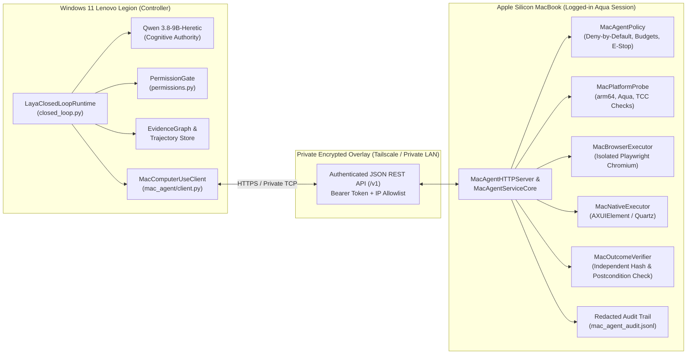

# PROJECT ALPHA — APPLE SILICON MAC COMPUTER-USE AGENT ARCHITECTURE

**Package:** `alpha/computer_use/mac_agent/`
**Controller Host:** Windows 11 Lenovo Legion (`AMD64`) running Project Alpha & Qwen (`qwen3.8-9b-heretic-uncensored`)
**Remote Execution Target:** Apple Silicon MacBook (`arm64` / macOS Aqua Session)
**API Version:** `v1`

---

## 1. Architectural Overview

The Apple Silicon Mac Computer-Use Agent enables Project Alpha running on the Windows 11 Lenovo Legion to observe, deliberate over, and control visible applications on a separate physical Apple Silicon MacBook without touching or taking over the Legion's physical mouse or keyboard.

The architecture enforces strict separation of concerns across five layers:
1. **Remote API & Transport Layer** ([`server.py`](alpha/computer_use/mac_agent/server.py), [`client.py`](alpha/computer_use/mac_agent/client.py), [`schemas.py`](alpha/computer_use/mac_agent/schemas.py))
2. **Deterministic Policy & Safety Enforcement Layer** ([`policy.py`](alpha/computer_use/mac_agent/policy.py))
3. **Platform & TCC Permission Probe Layer** ([`platform_probe.py`](alpha/computer_use/mac_agent/platform_probe.py))
4. **Observation & Action Execution Layer** ([`browser_executor.py`](alpha/computer_use/mac_agent/browser_executor.py), [`native_executor.py`](alpha/computer_use/mac_agent/native_executor.py))
5. **Independent Verification & Epistemic Lineage Layer** ([`verifier.py`](alpha/computer_use/mac_agent/verifier.py), [`closed_loop.py`](alpha/computer_use/closed_loop.py))

---

## 2. Closed-Loop Execution Sequence

Every task executed via `LayaClosedLoopRuntime` with `modality="MAC_BROWSER"` or `modality="MAC_NATIVE"` follows the deterministic 8-stage closed-loop contract:

1. **OBSERVE**: `MacComputerUseClient.observe()` requests a fresh `MacObservationPayload` from the MacBook, capturing URL/window title, interactive semantic elements, visible text wrapped in `<untrusted_environment_data>`, and a SHA-256 `state_hash`.
2. **FORM ACTION PROPOSAL**: `LayaClosedLoopRuntime._deliberate_next_action()` queries `QwenStrategicReasoner` on the Legion with the grounded observation to produce a structured `ModelActionProposal`.
3. **VALIDATE PERMISSIONS**:
   - **Legion Side**: `PermissionGate` validates `ApprovalToken` and action category.
   - **Mac Side**: `MacAgentPolicy` validates emergency stop state, task cancellation, rate limits, action/retry/duration budgets, URL/application allowlists, and consequential user confirmation gates.
4. **EXECUTE**: The approved action executes inside the isolated Playwright Chromium browser (`MacBrowserExecutor`) or native macOS application (`MacNativeExecutor`).
5. **OBSERVE AGAIN**: Immediately after execution, the Mac Agent acquires an independent post-action observation and computes `post_state_hash`.
6. **VERIFY**: `MacOutcomeVerifier` compares `pre_state_hash` vs `post_state_hash` and evaluates all `expected_postcondition` predicates, classifying the result honestly as `VERIFIED`, `FALSIFIED`, `INCONCLUSIVE`, or `UNRESOLVED`.
7. **PERSIST EVIDENCE**:
   - **Mac Side**: Writes secret-redacted JSONL record to `data/mac_agent_audit.jsonl`.
   - **Legion Side**: Registers `ActionNode` and `OutcomeNode` in `EvidenceGraph` and persists the full `ComputerUseTrajectory` to `data/trajectories/{task_id}_{run_id}.json` and `data/decision_audit_trail.jsonl`.
8. **UPDATE TASK STATE**: Updates task counters, triggers bounded recovery replanning if an action failed or produced no state change, or terminates on verified goal completion.

---

## 3. Component Responsibilities & File Map

| File | Responsibility |
|:---|:---|
| [`alpha/computer_use/mac_agent/platform_probe.py`](alpha/computer_use/mac_agent/platform_probe.py) | Detects Darwin kernel, `arm64` Apple Silicon, macOS version/build (`sw_vers`), non-root user UID, logged-in `Aqua` session (`launchctl managername`), and TCC permissions (`AXIsProcessTrusted`, `CGPreflightScreenCaptureAccess`, `System Events`). |
| [`alpha/computer_use/mac_agent/schemas.py`](alpha/computer_use/mac_agent/schemas.py) | Defines `v1` Pydantic models with `ConfigDict(extra="forbid")`, `MacActionType`, `SemanticLocator` (enforcing `coordinate_fallback_reason`), and observation/verification payloads. |
| [`alpha/computer_use/mac_agent/policy.py`](alpha/computer_use/mac_agent/policy.py) | Enforces deny-by-default URL/app allowlists, consequential action user confirmation, global emergency stop, per-task cancellation, sliding-window rate limits, action/duration/retry budgets, secret redaction, and untrusted content wrapping. |
| [`alpha/computer_use/mac_agent/browser_executor.py`](alpha/computer_use/mac_agent/browser_executor.py) | Dedicated single-thread Playwright Chromium worker with isolated browser profile (`alpha_mac_browser_profile_*`), semantic locators (`role`, `label`, `text`, `placeholder`, `test_id`, `element_id`, `css`), and DOM state hashing. |
| [`alpha/computer_use/mac_agent/native_executor.py`](alpha/computer_use/mac_agent/native_executor.py) | macOS Accessibility (`System Events` / `AXUIElement`) and `CoreGraphics` (`CGEvent`) actuator with TCC preflight checks and `screencapture` integration. |
| [`alpha/computer_use/mac_agent/harmless_test_app.py`](alpha/computer_use/mac_agent/harmless_test_app.py) | Harmless local Tkinter GUI application (`AlphaMacTestApp`) for safe end-to-end native vertical-slice verification. |
| [`alpha/computer_use/mac_agent/verifier.py`](alpha/computer_use/mac_agent/verifier.py) | Decoupled outcome verifier enforcing the invariant that failed or unobserved actions are never marked `VERIFIED`. |
| [`alpha/computer_use/mac_agent/server.py`](alpha/computer_use/mac_agent/server.py) | `MacAgentServiceCore` and `MacAgentHTTPServer` providing `/v1/health`, `/v1/readiness`, `/v1/capabilities`, `/v1/observe`, `/v1/execute_action`, `/v1/verify_outcome`, `/v1/task_status`, `/v1/cancel_task`, and `/v1/emergency_stop`. |
| [`alpha/computer_use/mac_agent/client.py`](alpha/computer_use/mac_agent/client.py) | `MacComputerUseClient` implementing `ILayaObservationTool` and `ILayaExecutionTool` for the Windows 11 Legion. |
| [`alpha/computer_use/mac_agent/cli.py`](alpha/computer_use/mac_agent/cli.py) | CLI startup and `--check-only` diagnostic utility for the MacBook. |

---

## 4. macOS Version Compatibility & Session Constraints

- **Runtime Version Detection**: Never assumes a fixed macOS version. `MacPlatformProbe` inspects `platform.mac_ver()` and `/usr/bin/sw_vers` at runtime and records compatibility notes for macOS 13 Ventura, macOS 14 Sonoma, macOS 15 Sequoia, and macOS 16/26+.
- **Graphical Session Requirement**: GUI automation on macOS must run inside the logged-in user's `Aqua` session. Running as `root` (`sudo` or `LaunchDaemon`) is explicitly rejected by `MacPlatformProbe` (`ROOT_SESSION_FORBIDDEN`).
