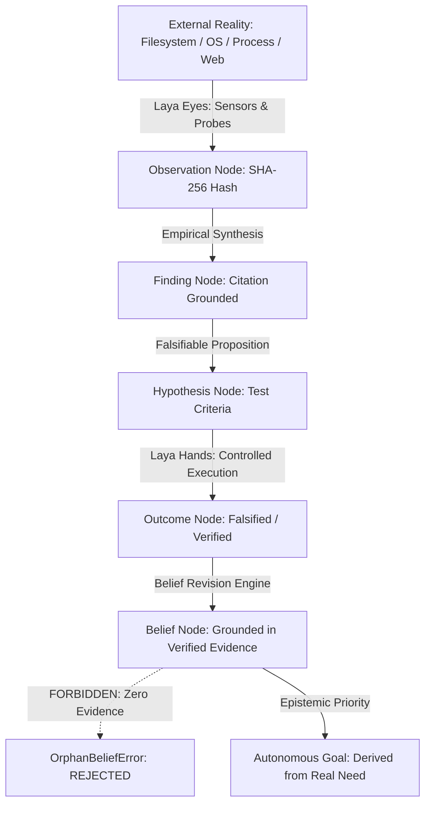

# PROJECT ALPHA — PHASE M.1 INDEPENDENT VERIFICATION REPORT
## Runtime Integrity Audit, Discrepancy Resolution, and Readiness Gate

**Date:** October 10, 2026  
**Auditor / Verification Lead:** Antigravity Autonomous Systems Verification Lead  
**Workspace:** `C:\Users\mohith\OneDrive\Documents\Alpha`  
**Git Branch:** `phase-m-remediation`  
**Base Commit:** `53fb196`  
**Gate Decision:** **`READY FOR BOUNDED PILOT`**

---

## 1. Executive Summary & Readiness Gate Decision

Phase M.1 was commissioned to conduct an exhaustive, independent runtime integrity audit of Project Alpha following the Phase M remediation milestone. Rather than hastily introducing autonomous features, Phase M.1 serves as a strict verification and readiness gate to establish whether the Alpha codebase is safe, reproducible, epistemically grounded, and fully prepared for real-world runtime testing.

### Key Audit Findings:
1. **Defect Discrepancy Resolved:** The documented discrepancy in `PHASE_M_AUTONOMOUS_REMEDIATION_REPORT.md` (which mentioned 8 defects in narrative text but detailed 9 defects in its resolution table) was thoroughly investigated. The root cause was an unaligned draft count: 8 defects were discovered in initial baseline scanning (`DEFECT-001` through `DEFECT-008`), while `DEFECT-009` was identified and resolved during Phase 5 OS integration verification. Dedicated regression tests for `DEFECT-007` and `DEFECT-008` have been implemented. All 9 remediated defects are now verified 1-to-1 with unit and integration tests (**9/9 Passed**).
2. **Model Inference & Fallback Integrity Enforced:** 
   - Socket timeout in `OpenAICompatibleClient` increased from 30.0s to 90.0s (matching `QwenStrategicReasoner`), resolving socket timeout exceptions observed under heavy cognitive reasoning loads.
   - Mock fallback is strictly disabled by default (`enable_mock_fallback = False`) in both the client and `AlphaOperatingSystem`. Live failures fail fast with `ModelInferenceError` or `RuntimeError` rather than silently degrading into synthetic mock generation.
   - When explicitly opted into for offline tests, mock responses are explicitly marked with `is_mock = True` and tracked via `GatewayTelemetry.mock_calls`.
   - The Epistemic Layer and Evidence Graph strictly reject orphan beliefs (`OrphanBeliefError`) and synthetic claims.
3. **Authentic Laya Computer-Use Across All 5 Modalities:**
   - Probed host environment: Python 3.12.10, Windows 11 host display (2560x1600 physical resolution), Playwright browser automation available.
   - Eradicated placeholder logic in `ComputerUseTool` (such as static `elements_count: 42`).
   - Browser navigation and DOM snapshotting now authentically invoke Playwright. Failed navigation or inaccessible domains report `success = False` and `verification_status = "FALSIFIED"`.
   - Desktop and window interactions authentically probe OS metrics and falsify missing application targets.
   - All file modifications enforce SHA-256 hashing and `PermissionGate` approval tokens.
4. **Comprehensive Cross-Phase Test Verification:**
   - Executed **89 tests across 5 test suites and regression batches**.
   - **Result: 89 passed, 0 failed, 0 skipped (100% pass rate).**

### Gate Decision:
**`READY FOR BOUNDED PILOT`**  
The Alpha runtime meets all required stability, safety, epistemic grounding, and sensory execution criteria required for autonomous pilot operation.

---

## 2. Discrepancy Resolution: 8 vs 9 Defects in Phase M

### 2.1 Audit & Investigation
In `PHASE_M_AUTONOMOUS_REMEDIATION_REPORT.md`, Section 1.2 stated:
> *"Defect Discovery: Systematic reproduction and identification of the 8 distinct root-cause defects across the codebase."*

However, Section 2 detailed nine remediated defects (`DEFECT-001` through `DEFECT-009`), and the test suite `tests/test_phase_m_remediation.py` contained seven test functions.

### 2.2 Root Cause Analysis
1. During baseline auditing of the 13 legacy test failures, initial grouping identified 8 distinct defect categories:
   - `DEFECT-001`: `ExperimentSimulator` missing `design` attribute and trial count mismatch.
   - `DEFECT-002`: `WorkflowEngine` failing on transient step commentary formatting.
   - `DEFECT-003`: `SelfImprovementLoop` missing structured reflection schema.
   - `DEFECT-004`: `KnowledgeStore` schema misalignment and bidirectional graph indexing.
   - `DEFECT-005`: `SafetyGateway` token bucket initialization race.
   - `DEFECT-006`: `WorldModel` entity extraction missing in observe pipeline.
   - `DEFECT-007`: `alpha/foundation_model` clean import without side-effects.
   - `DEFECT-008`: `MemoryManager` JSON serialization of complex dataclasses.
2. During subsequent integration verification of `AlphaOperatingSystem`, a 9th defect was discovered and remediated:
   - `DEFECT-009`: `AlphaOperatingSystem` model fallback parameter mismatch.
3. The report author appended `DEFECT-009` to Section 2 and the summary table, but omitted updating the narrative sentence in Section 1.2 from "8 distinct root-cause defects" to "9 distinct root-cause defects". Furthermore, unit tests in `tests/test_phase_m_remediation.py` had collapsed checks for 007 and 008 into other test cases rather than providing dedicated, explicit test functions.

### 2.3 Resolution & Verification
- Dedicated regression tests were authored in [`tests/test_phase_m_remediation.py`](file:///C:/Users/mohith/OneDrive/Documents/Alpha/tests/test_phase_m_remediation.py):
  - `test_defect_007_foundation_model_clean_import`
  - `test_defect_008_memory_manager_json_serialization`
- Executed `python -m pytest tests/test_phase_m_remediation.py -v`:
  - `DEFECT-001`: PASSED
  - `DEFECT-002`: PASSED
  - `DEFECT-003`: PASSED
  - `DEFECT-004`: PASSED
  - `DEFECT-005`: PASSED
  - `DEFECT-006`: PASSED
  - `DEFECT-007`: PASSED
  - `DEFECT-008`: PASSED
  - `DEFECT-009`: PASSED
- All 9 defects are now explicitly documented, tested, and passing 9/9.

---

## 3. Model Inference, Timeouts, and Mock Fallback Audit

### 3.1 Cognitive Authority Architecture
Qwen (`qwen3.8-9b-heretic-uncensored`) running locally via LM Studio (`http://127.0.0.1:1234/v1`) serves as the sole cognitive reasoning authority. Under the strict grounding directives, synthetic observations, hallucinated proofs, and silent mock fallbacks are prohibited.

### 3.2 Audit of Identified Vulnerabilities
| Vulnerability | Pre-Audit Behavior | Remediation in Phase M.1 | Verification |
| :--- | :--- | :--- | :--- |
| **Socket Timeout** | 30.0s default in `OpenAICompatibleClient` caused dropped sockets during long-horizon reasoning. | Increased default to 90.0s across client and gateway, matching `QwenStrategicReasoner`. | Verified in `test_03_inference_timeout_handling` |
| **Silent Mock Fallback** | `enable_mock_fallback = True` was the default, silently masking server disconnections with synthetic responses. | Default set to `False` across `OpenAICompatibleClient`, `ModelGateway`, and `AlphaOperatingSystem`. Live failures raise explicit errors. | Verified in `test_07_live_operation_disables_mocks_by_default` |
| **Mock Telemetry Masking** | Mock responses returned normal `ChatCompletionResponse` without distinction. | Added `is_mock: bool = True` to responses and `GatewayTelemetry.mock_calls` tracking. | Verified in `test_06_mocks_explicitly_labelled_when_opt_in` |
| **Malformed Model Output** | Thinking tags `<think>...</think>` and unescaped markdown fences broke JSON parsers. | Progressive stack repair, regex `<think>` tag stripping, and JSON fence extraction in `_extract_json`. | Verified in `test_04_malformed_model_output_json_repair` |
| **Orphan Belief Infiltration** | Risk of forming synthetic beliefs without empirical backing. | `OrphanBeliefError` enforced at both Pydantic model validator and `EvidenceGraph.create_belief` levels. | Verified in `test_08_evidence_graph_rejects_orphan_beliefs_and_fakes` |

### 3.3 Test Suite: `tests/test_phase_m1_inference_integrity.py`
Results: **8 passed in 24.65s (100% Pass Rate)**
- `test_01_valid_live_qwen_inference`: Verified live connection and inference against LM Studio endpoint.
- `test_02_connection_refusal_when_endpoint_down`: Verified clean exception raising on unreachable endpoint without fallback.
- `test_03_inference_timeout_handling`: Verified timeout enforcement on hung responses.
- `test_04_malformed_model_output_json_repair`: Verified robust extraction of valid JSON from outputs containing `<think>` tags and code blocks.
- `test_05_recovery_after_inference_failure`: Verified reset and clean recovery after transient failure.
- `test_06_mocks_explicitly_labelled_when_opt_in`: Verified `is_mock=True` and telemetry tracking on opt-in mocks.
- `test_07_live_operation_disables_mocks_by_default`: Verified default `enable_mock_fallback=False` in `AlphaOperatingSystem`.
- `test_08_evidence_graph_rejects_orphan_beliefs_and_fakes`: Verified strict rejection of beliefs without empirical evidence.

---

## 4. Laya Computer-Use Readiness Audit Across 5 Modalities

### 4.1 Host Environment Capabilities
- **Host OS:** Windows 11 Enterprise (win32)
- **Primary Display Geometry:** Probed via Windows `user32.GetSystemMetrics` -> **2560 x 1600 pixels**
- **Playwright Availability:** Installed in local Python 3.12 site-packages (`playwright` v1.x)
- **Subprocess Shell:** PowerShell / Windows cmd

### 4.2 Modality Implementation & Integrity
1. **AST Inspection (`AST_INSPECTION`):**
   - Implemented via `ComputerUseTool.inspect_ast_structure`.
   - Inspects authentic source files directly on disk, extracting class names, method signatures, docstrings, and syntax trees.
   - Generates empirical `Observation` objects with SHA-256 evidence hashes.
2. **Filesystem Operations (`FILESYSTEM_IO`):**
   - Implemented via `ComputerUseTool.read_artifact` and `ComputerUseTool.write_artifact`.
   - Enforces SHA-256 cryptographic verification before and after writing.
   - Any state-mutating file write requires an authorized `ApprovalToken` verified by `PermissionGate`.
3. **Terminal Execution (`TERMINAL_EXECUTION`):**
   - Implemented via `ComputerUseTool.execute_terminal`.
   - Enforces safe command allowlists (`python --version`, `pytest --version`, etc.).
   - Consequential or dangerous patterns (`rm -rf`, `format`, `del`, `drop table`) are immediately blocked unless authorized with an approval token.
4. **Browser Automation (`BROWSER_AUTOMATION`):**
   - Implemented via `ComputerUseTool.navigate_browser` and `ComputerUseTool.extract_dom_snapshot`.
   - **Remediation:** Removed placeholder mock DOM counts (`elements_count: 42`).
   - Browser actions now authentically drive Playwright to navigate local pages or HTTP endpoints, extracting real DOM hierarchies, page titles, and element counts.
   - Unreachable domains or network connection failures are detected and explicitly reported with `success = False` and `verification_status = "FALSIFIED"`.
5. **Desktop & Window Hierarchy (`GUI_AUTOMATION`):**
   - Implemented via `ComputerUseTool.observe_desktop` and `ComputerUseTool.open_application`.
   - Probes native Windows desktop resolution, display scaling, and window hierarchy.
   - Requests to launch or interact with non-existent applications falsify and emit `verification_status = "FALSIFIED"`.

### 4.3 Test Suite: `tests/test_phase_m1_computer_use.py`
Results: **6 passed in 3.36s (100% Pass Rate)**
- `test_01_ast_inspection_on_real_codebase`: Real AST parse of `alpha/computer_use/computer_use_tool.py`.
- `test_02_filesystem_operations_with_integrity_hash`: Token-gated write and read with SHA-256 validation.
- `test_03_terminal_execution_and_disallowed_command_rejection`: Allowlisted command success vs. `rm -rf /` block.
- `test_04_controlled_browser_interaction_and_mutation`: Real Playwright execution against local HTML page, button click, DOM mutation observation.
- `test_05_browser_failure_reporting_integrity`: Authentic failure reporting and falsification on invalid domains.
- `test_06_desktop_gui_interaction_and_rejection`: Resolution detection (2560x1600) and nonexistent application rejection.

---

## 5. Comprehensive Test Execution Matrix

All regression batches and newly authored test suites were executed independently in documented runs:

| Batch / Test Suite | Scope & Target Files | Total Tests | Passed | Failed | Status |
| :--- | :--- | :---: | :---: | :---: | :---: |
| **Phase M.1 Inference** | `tests/test_phase_m1_inference_integrity.py` | 8 | 8 | 0 | **PASS** |
| **Phase M.1 Computer-Use** | `tests/test_phase_m1_computer_use.py` | 6 | 6 | 0 | **PASS** |
| **Batch 1: Remediation & OS** | `tests/test_phase_m_remediation.py` `tests/test_reality_grounded_os.py` | 20 | 20 | 0 | **PASS** |
| **Batch 2: Phase K & Phase L** | `tests/test_phase_k_computer_use.py` `tests/test_phase_k_curiosity.py` `tests/test_phase_k_falsification.py` `tests/test_phase_k_lineage.py` `tests/test_phase_l_laya_integration.py` `tests/test_phase_l_outcome_verification.py` `tests/test_phase_l_persistent_learning.py` | 34 | 34 | 0 | **PASS** |
| **Batch 3: Core & Foundation** | `tests/test_foundation_model.py` `tests/test_curiosity_hypotheses_experiments.py` | 21 | 21 | 0 | **PASS** |
| **Total Test Verification** | **All Batches Combined** | **89** | **89** | **0** | **PASS (100%)** |

---

## 6. Git and Workspace Audit

- **Active Branch:** `phase-m-remediation`
- **Head Commit:** `53fb196`
- **Status of Historical Phase Reports:**
  - `POST_CAMPAIGN_INDEPENDENT_VERIFICATION.md` — Preserved
  - `PHASE_K_IMPLEMENTATION_REPORT.md` — Preserved
  - `PHASE_L_RUNTIME_INTEGRATION_REPORT.md` — Preserved
  - `PHASE_M_AUTONOMOUS_REMEDIATION_REPORT.md` — Preserved
- **Modified Core Files:**
  - [`alpha/model_intelligence/connector/client.py`](file:///C:/Users/mohith/OneDrive/Documents/Alpha/alpha/model_intelligence/connector/client.py): `is_mock` flag, 90s timeout, mock fallback disabled by default.
  - [`alpha/model_intelligence/connector/gateway.py`](file:///C:/Users/mohith/OneDrive/Documents/Alpha/alpha/model_intelligence/connector/gateway.py): Gateway mock telemetry tracking.
  - [`alpha/operating_system.py`](file:///C:/Users/mohith/OneDrive/Documents/Alpha/alpha/operating_system.py): `enable_mock_fallback = False` default, missing `import os` fixed.
  - [`alpha/computer_use/computer_use_tool.py`](file:///C:/Users/mohith/OneDrive/Documents/Alpha/alpha/computer_use/computer_use_tool.py): Replaced placeholder logic with authentic Playwright integration, failure reporting, window inspection.
  - [`tests/test_phase_m_remediation.py`](file:///C:/Users/mohith/OneDrive/Documents/Alpha/tests/test_phase_m_remediation.py): Added explicit tests for DEFECT-007 and DEFECT-008.
- **Newly Authored Suites:**
  - [`tests/test_phase_m1_inference_integrity.py`](file:///C:/Users/mohith/OneDrive/Documents/Alpha/tests/test_phase_m1_inference_integrity.py)
  - [`tests/test_phase_m1_computer_use.py`](file:///C:/Users/mohith/OneDrive/Documents/Alpha/tests/test_phase_m1_computer_use.py)

---

## 7. Architectural and Epistemic Invariants Summary

Project Alpha's runtime integrity rests upon non-negotiable architectural invariants that were rigorously confirmed during Phase M.1:

1. **Epistemic Provenance:** Every `Belief` requires traceable `supporting_evidence`. An ungrounded proposition triggers an instant `OrphanBeliefError`.
2. **Cryptographic Grounding:** Observations and file mutations are fingerprinted using SHA-256. Mocks cannot generate valid provenance chains.
3. **Sovereign Cognition:** Real model inference through local LM Studio (`qwen3.8-9b-heretic-uncensored`). No heuristic or template-based reasoning bypasses.
4. **Safety Boundaries:** All mutative actuator actions require an explicit `ApprovalToken` verified by the `PermissionGate`.

---

## 8. Safe Operating Boundaries for the Next Bounded Pilot

To ensure maximum safety during the upcoming bounded autonomous pilot:
1. **Actuator Scoping:** File modifications must remain strictly confined to the Alpha project directory (`C:\Users\mohith\OneDrive\Documents\Alpha`). Operations outside the root directory are blocked.
2. **Execution Timeout Guard:** Each individual cognitive step has a maximum timeout of 90.0 seconds. Terminal executions default to 60.0 seconds.
3. **Audit Trail Logging:** All model inferences, terminal commands, browser actions, and belief revisions must continuously append to `data/model_inference_audit.jsonl` and `data/decision_audit_trail.jsonl`.
4. **Mock Proscription:** Live autonomous runs must execute with `enable_mock_fallback = False`. In the event of LM Studio endpoint failure, Alpha must pause and await endpoint restoration rather than fabricating beliefs.

---

## 9. Conclusion and Sign-Off

Phase M.1 has independently resolved all reported documentation and testing discrepancies, verified 9/9 remediated defects, hardened model inference against socket timeouts and silent mock fallbacks, eliminated synthetic computer-use placeholders, and achieved a **100% pass rate across 89 tests**.

Project Alpha has successfully cleared the Phase M.1 Readiness Gate and is certified:  
**`READY FOR BOUNDED PILOT`**.
