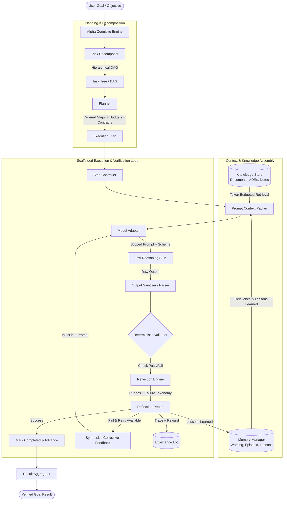
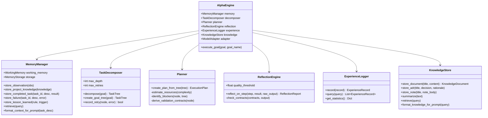
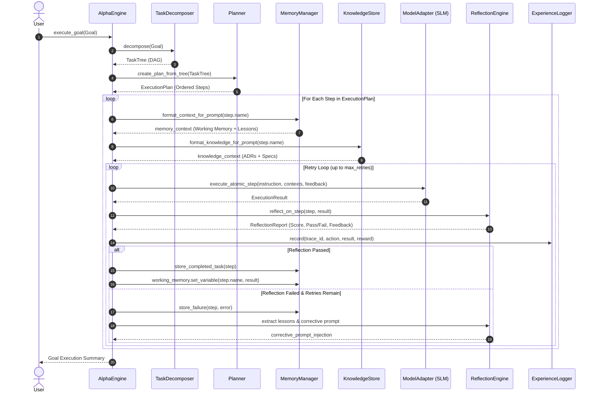

# Alpha Phase 1: Cognitive Scaffolding Layer Specification

## Executive Summary & Core Principle
Phase 1 transforms low-reasoning, low-context foundation language models (SLMs, 1B–7B parameters, quantized weights) into capable, reliable cognitive systems without modifying their weights. 

**Core Principle:**
> **Do not rely on model intelligence.** Assume the foundation model is weak, prone to hallucination, forgetful across turns, easily overwhelmed by context length, and inconsistent in structure. All intelligence gains must be engineered into external scaffolding: deterministic state machines, budgeted context assembly, hierarchical task decomposition, topological dependency graphs, validation contracts, reflective critique loops, and persistent experience logging.

---

## 1. Complete System Architecture



---

## 2. Component Architecture

The system comprises 6 decoupled components managed by the `AlphaEngine`:



---

## 3. Folder Structure

```
Alpha/
├── PROJECT_ALPHA_SOURCE_OF_TRUTH.md      # Root system roadmap and phase milestones
├── run_demo.py                           # Interactive scaffolding demonstration
├── data/                                 # Persistent database directory
│   └── alpha_scaffolding.db              # SQLite storage with FTS5 virtual tables
├── docs/                                 # Complete architecture specifications
│   └── PHASE_1_COGNITIVE_SCAFFOLDING_SPEC.md
├── alpha/                                # Phase 1 Python package
│   ├── __init__.py                       # Package exports and versioning
│   ├── config.py                         # Settings, token budgets, thresholds
│   ├── core/                             # Core orchestrator and interfaces
│   │   ├── __init__.py
│   │   ├── types.py                      # System enums, TaskLevel, TaskStatus, etc.
│   │   ├── model_adapter.py              # Prompt framing, sanitization, SLM simulator
│   │   └── engine.py                     # Master AlphaEngine cognitive loop
│   ├── memory/                           # Component 1: Memory Manager
│   │   ├── __init__.py
│   │   ├── schemas.py                    # MemoryItem, WorkingMemory, MemoryQuery
│   │   ├── storage.py                    # SQLite + FTS5 indexing
│   │   └── manager.py                    # Ingestion pipeline & context formatting
│   ├── decomposer/                       # Component 2: Task Decomposer
│   │   ├── __init__.py
│   │   ├── schemas.py                    # TaskNode, TaskTree (DAG)
│   │   └── decomposer.py                 # Hierarchical decomposition & topological sort
│   ├── planner/                          # Component 3: Planner
│   │   ├── __init__.py
│   │   ├── schemas.py                    # ExecutionPlan, ExecutionStep, ResourceEstimate
│   │   └── planner.py                    # Step ordering, complexity & validation contracts
│   ├── reflection/                       # Component 4: Reflection Engine
│   │   ├── __init__.py
│   │   ├── schemas.py                    # ReflectionReport, RubricScore, FailurePattern
│   │   └── engine.py                     # Evaluator, corrective prompt generator
│   ├── experience/                       # Component 5: Experience Log
│   │   ├── __init__.py
│   │   ├── schemas.py                    # ExperienceRecord, ExperienceQuery
│   │   └── logger.py                     # Append-only audit logger & metrics
│   └── knowledge/                        # Component 6: Knowledge Store
│       ├── __init__.py
│       ├── schemas.py                    # KnowledgeDocument, KnowledgeQuery
│       └── store.py                      # Documents, ADRs, extractive summarizer
└── tests/                                # Test suite (100% pass)
    ├── __init__.py
    ├── test_memory.py                    # Memory storage, retrieval, working memory
    ├── test_decomposer.py                # Tree hierarchy, DAG sorting, retry tracking
    ├── test_planner.py                   # Plan generation, resource estimates, contracts
    ├── test_reflection.py                # Rubric scoring, failure recovery, lessons
    ├── test_experience.py                # Execution audit trail, rewards, stats
    ├── test_knowledge.py                 # Document indexing, ADRs, summarization
    └── test_scaffolding_pipeline.py      # End-to-end cognitive loop & recovery test
```

---

## 4. Database Schema (SQLite + FTS5)

Alpha Phase 1 uses an embedded SQLite database engine (`alpha_scaffolding.db`) requiring no external server daemons, with native Full-Text Search (FTS5) for keyword and token matching.

### 4.1 Memories Table (`memories`)
```sql
CREATE TABLE memories (
    id TEXT PRIMARY KEY,
    memory_type TEXT NOT NULL,       -- observation, project_knowledge, completed_task, failure, lesson_learned
    content TEXT NOT NULL,
    metadata_json TEXT NOT NULL,
    tags_json TEXT NOT NULL,
    importance REAL NOT NULL,        -- 0.0 to 1.0
    access_count INTEGER NOT NULL DEFAULT 0,
    created_at TEXT NOT NULL,        -- ISO-8601 UTC
    last_accessed_at TEXT NOT NULL
);

CREATE INDEX idx_mem_type ON memories(memory_type);
CREATE INDEX idx_mem_importance ON memories(importance);
CREATE INDEX idx_mem_created ON memories(created_at);

-- FTS5 Full-Text Index
CREATE VIRTUAL TABLE memories_fts USING fts5(
    id UNINDEXED,
    content,
    tags
);
```

### 4.2 Experience Logs Table (`experience_logs`)
```sql
CREATE TABLE experience_logs (
    trace_id TEXT PRIMARY KEY,
    task_id TEXT NOT NULL,
    step_number INTEGER,
    goal_id TEXT,
    decision_context_json TEXT NOT NULL,  -- Context snapshot passed to SLM
    action_taken TEXT NOT NULL,           -- Prompt / instruction attempted
    model_output TEXT NOT NULL,           -- Raw SLM output
    success INTEGER NOT NULL,             -- 1 = True, 0 = False
    reward REAL NOT NULL,                 -- -1.0 to 1.0
    latency_ms REAL NOT NULL,
    tokens_used_est INTEGER NOT NULL,
    reflection_report_id TEXT,
    error_message TEXT,
    timestamp TEXT NOT NULL
);

CREATE INDEX idx_exp_task ON experience_logs(task_id);
CREATE INDEX idx_exp_success ON experience_logs(success);
CREATE INDEX idx_exp_reward ON experience_logs(reward);
CREATE INDEX idx_exp_time ON experience_logs(timestamp);
```

### 4.3 Knowledge Documents Table (`knowledge_docs`)
```sql
CREATE TABLE knowledge_docs (
    doc_id TEXT PRIMARY KEY,
    title TEXT NOT NULL,
    doc_type TEXT NOT NULL,          -- document, project_note, adr, research, heuristic
    content TEXT NOT NULL,
    summary TEXT,
    tags_json TEXT NOT NULL,
    metadata_json TEXT NOT NULL,
    created_at TEXT NOT NULL,
    updated_at TEXT NOT NULL
);

CREATE INDEX idx_kdoc_type ON knowledge_docs(doc_type);
CREATE INDEX idx_kdoc_title ON knowledge_docs(title);

-- FTS5 Full-Text Index
CREATE VIRTUAL TABLE knowledge_fts USING fts5(
    doc_id UNINDEXED,
    title,
    content,
    summary,
    tags
);
```

---

## 5. Data Flow Diagrams

### 5.1 End-to-End Cognitive Scaffolding Loop


---

## 6. API Specifications

### 6.1 `AlphaEngine`
- `execute_goal(goal: str, goal_name: Optional[str] = None, structured_steps: Optional[List[Dict[str, Any]]] = None) -> Dict[str, Any]`
  Executes a high-level goal through the full scaffolding pipeline.

### 6.2 `MemoryManager`
- `store_observation(observation: str, context: Optional[Dict[str, Any]] = None) -> MemoryItem`
- `store_project_knowledge(knowledge: str, tags: Optional[List[str]] = None, metadata: Optional[Dict[str, Any]] = None) -> MemoryItem`
- `store_completed_task(task_id: str, description: str, result_summary: str, latency_ms: float = 0.0) -> MemoryItem`
- `store_failure(task_id: str, description: str, error_message: str, root_cause: Optional[str] = None) -> MemoryItem`
- `store_lesson_learned(rule: str, context_trigger: str, rationale: Optional[str] = None) -> MemoryItem`
- `retrieve(query_text: Optional[str] = None, memory_types: Optional[List[MemoryType]] = None, limit: int = 5, max_tokens: int = 600) -> List[MemoryItem]`
- `format_context_for_prompt(task_description: str, max_tokens: int = 600) -> str`

### 6.3 `TaskDecomposer`
- `decompose(goal_description: str, goal_name: Optional[str] = None, structured_steps: Optional[List[Dict[str, Any]]] = None) -> TaskTree`
- `record_retry(node: TaskNode, error: str) -> bool`

### 6.4 `Planner`
- `create_plan_from_tree(tree: TaskTree) -> ExecutionPlan`

### 6.5 `ReflectionEngine`
- `reflect_on_step(step: ExecutionStep, result: ExecutionResult, raw_output: str) -> ReflectionReport`

### 6.6 `ExperienceLogger`
- `record(record: ExperienceRecord) -> ExperienceRecord`
- `query(query: ExperienceQuery) -> List[ExperienceRecord]`
- `get_statistics() -> Dict[str, Any]`

### 6.7 `KnowledgeStore`
- `store_document(title: str, content: str, doc_type: KnowledgeType = KnowledgeType.DOCUMENT, tags: Optional[List[str]] = None) -> KnowledgeDocument`
- `store_adr(title: str, decision: str, rationale: str, status: str = "ACCEPTED") -> KnowledgeDocument`
- `store_note(title: str, note_body: str, tags: Optional[List[str]] = None) -> KnowledgeDocument`
- `summarize(text: str, max_sentences: int = 2) -> str`
- `retrieve(query: KnowledgeQuery) -> List[KnowledgeDocument]`
- `format_knowledge_for_prompt(query_text: str, max_tokens: int = 500) -> str`

---

## 7. Schemas: Memory, Reflection, and Experience Log

### 7.1 Memory Schemas
```python
class MemoryType(str, Enum):
    OBSERVATION = "observation"
    PROJECT_KNOWLEDGE = "project_knowledge"
    COMPLETED_TASK = "completed_task"
    FAILURE = "failure"
    LESSON_LEARNED = "lesson_learned"

class MemoryItem(BaseModel):
    id: str
    memory_type: MemoryType
    content: str
    metadata: Dict[str, Any]
    tags: List[str]
    importance: float
    access_count: int
    created_at: datetime
    last_accessed_at: datetime
```

### 7.2 Reflection Schemas
```python
class RubricScore(BaseModel):
    criterion: str           # "non_emptiness", "contract_adherence", "conciseness"
    score: float             # 0.0 to 1.0
    feedback: str

class FailurePattern(BaseModel):
    category: str            # "empty_output", "contract_violation", "schema_error"
    symptom: str
    suspected_cause: str

class LessonLearned(BaseModel):
    rule: str
    trigger: str
    rationale: str

class ReflectionReport(BaseModel):
    report_id: str
    task_id: str
    step_number: Optional[int]
    overall_score: float
    passed: bool
    what_worked: List[str]
    what_failed: List[str]
    what_can_improve: List[str]
    rubric_scores: List[RubricScore]
    failures: List[FailurePattern]
    lessons: List[LessonLearned]
    corrective_prompt_injection: Optional[str]
    created_at: datetime
```

### 7.3 Experience Log Schema
```python
class ExperienceRecord(BaseModel):
    trace_id: str
    task_id: str
    step_number: Optional[int]
    goal_id: Optional[str]
    decision_context: Dict[str, Any]
    action_taken: str
    model_output: str
    success: bool
    reward: float            # -1.0 to 1.0
    latency_ms: float
    tokens_used_est: int
    reflection_report_id: Optional[str]
    error_message: Optional[str]
    timestamp: datetime
```

---

## 8. Validation Strategy

To ensure a small model operates reliably:
1. **Deterministic Contracts**: Every step defines assertions (e.g. non-empty text, valid JSON schema, required keywords). The SLM is NEVER trusted to grade itself without deterministic checks.
2. **Strict Context Budgeting**: SLMs degrade rapidly when context exceeds 2048 tokens. Scaffolding caps working memory, knowledge retrieval (500 tokens), and memory lessons (600 tokens), preventing context rot.
3. **Atomic Decomposition**: No atomic action is allowed to exceed Complexity Level 2 (Low). Complex reasoning is converted into sequential 1-step transforms.
4. **Iterative Self-Correction Loop**: If validation fails, ReflectionEngine pinpoints the failure, generates a corrective prompt, and retries.
5. **Reward Attribution**: Rewards (+1.0 for pass, -0.5 for fail) are logged to the Experience Log to track performance over time.
